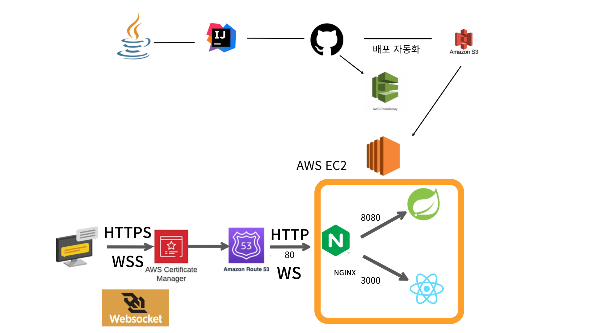

## CS Quiz 풀이 프로젝트

### 개요

IT 연합동아리 코테이토의 정규 세션 ‘CS 교육’ 이후 진행되는 CS 퀴즈 문제풀이 진행 시 참여율 개선을 목적으로 제작한 프로젝트이다.

**기존 방식의 문제점**

기존 ‘카카오톡 오픈채팅방’을 통해 진행되는 프로젝트는 아래와 같은 문제가 있었다.

- 공개된 채팅방에서 진행됨에 따라 어려운 문제 참여율 저조
- 우승자가 결정된 이후의 문제 참여율 저조

### 결과

해당 프로젝트는 현재 IT연합동아리 코테이토의 매주 진행되는 정규세션에서 사용 중이며 개선 중이며 약 5배 가량 참여율을 개선했습니다.

[실제 사용 링크](https://www.cotato.kr/)

 

### 핵심 기능

- 선착순 사용자 문제 풀이 기능
- 실시간 문제 풀이 신호 전송 기능
- 기수별 최상위 정답, 득점자 조회 기능

### 아키텍처

### 개발 기간

Ver1 : 2023.10 ~ 2024.02
 
Ver2 : 현재 동아리 자체 사이트 제작을 목표로 개발 중입니다.

## Members

|  |  |  |
|:--------------------------------------------------------------------------------------------------:|:----------------------------------------------------------------------------------------------:|:-----------------------------------------------------------------------------------------------------:|
|                           <a href="https://github.com/Youthhing">신유승</a>                           |                          <a href="https://github.com/gikhoon">남기훈</a>                          |                            <a href="https://github.com/yunhacandy">박윤하</a>                            |                        
|                                             [ 백엔드 팀장 ]                                             |                                           [ 백엔드 팀원 ]                                           |                                              [ 백엔드 팀원 ]                                               | 

### 개발 기록

지속적으로 작성 중에 있습니다.

[[유승]: ErrorResponse로 전달할 필드에 대한 고민](https://youthing.tistory.com/199)
 
[[유승]: 여러 객체를 동시에 삭제하는 쿼리 줄이기](https://youthing.tistory.com/202)
 
[[유승]: ENUM 그룹화를 통한 MemberRole 관리하기](https://youthing.tistory.com/209)
